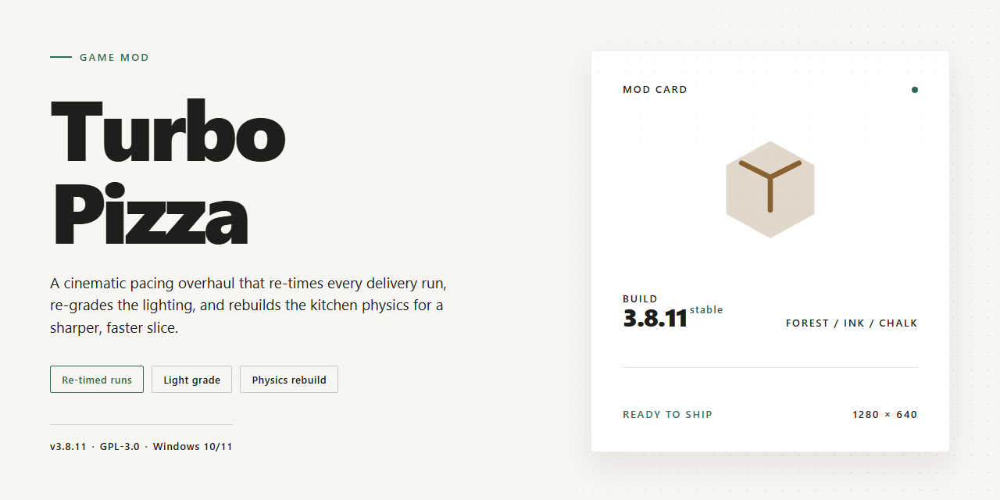

# 🍕 Turbo-Pizza: Serve Slices at Full Throttle for Windows

### 🖥️ PowerShell Setup

   

---

Turbo Pizza drops you behind the counter of a neon-lit parlor where every order is a ticking clock and every perfect pie builds your reputation. This README is your backstage pass — the place where tinkerers, tuners, and full-conversion dreamers can poke at the guts of the game and make the kitchen their own. Whether you're here to rebalance recipes, reskin the dining room, or just see how the sausage (or pepperoni) gets made, the oven's already hot. Fork it, break it, rebuild it — just don't let the customers wait too long.

## 📋 System Requirements

- Windows 10 or Windows 11
- PowerShell 5.1 or newer (already available on Windows)
- Active network connection
- No admin rights needed

## Features

Welcome to the kitchen, chef. Turbo-Pizza is a full-flavored management sim for Windows, and this is where the modding community gets to poke around under the hood. Whether you're here to play the parlor rush straight or to bend the recipe book to your will, here's what's on the menu.

### 🍕 The Core Oven — Gameplay Systems

- **Order Rush Management** — Customers queue up with tickets, patience timers, and expectations. The whole loop lives in data, which means order pacing, spawn rates, and ticket variety are all yours to tune.
- **Recipe & Prep Pipeline** — Dough, sauce, toppings, baking, and plating are handled as discrete steps. Modders can dig into the recipe tables to add signature pies, tweak prep times, or rebalance entire menus.
- **Progressive Upgrade Path** — Equipment, decorations, and recipe unlocks scale with your parlor's reputation. Upgrade costs and unlock gates sit in editable configs, so difficulty curves are never locked in stone.

### ⚙️ Modder-Friendly Architecture

- **Data-Driven Definitions** — Recipes, customers, upgrades, and level thresholds are defined in structured files rather than hardcoded logic. Swap values, add entries, and watch the parlor change.
- **Drop-In Content Folders** — New content is picked up from a dedicated mod directory. Package your creations cleanly and keep them separate from the base game.
- **Readable Config Formats** — No obfuscated binaries standing between you and the numbers. Edit a file, relaunch, and test — the fastest possible iteration loop.

### 🕹️ Vibrant Parlor Presentation

- **Bright, Cartoon-Style Visuals** — A colorful art direction that's easy to extend with custom customer skins, storefront themes, or entirely new restaurant vibes.
- **Point-and-Click Controls** — Simple input handling that stays out of the way of gameplay mods and UI tweaks.
- **Atmospheric Audio Hooks** — Sound triggers tied to gameplay events, ready for custom jingles, oven pings, or a fully remixed soundtrack.

### ⏱️ Challenge & Replayability

- **Timer-Driven Tension** — Race the clock to clear orders before patience runs dry. Timer multipliers are config-exposed for custom difficulty flavors.
- **Level Progression & Unlocks** — New challenges, customer types, and scenarios open as you grow. Level definitions are plain data, so custom campaign tiers slot right in.
- **Endless Replay Potential** — Randomized order patterns keep vanilla runs fresh — and give modders a perfect playground for new rule sets.

### 🛠️ Built for Tinkering

- **Clean Extensibility Boundaries** — Gameplay, data, and presentation layers are separated so a recipe mod never has to touch the renderer, and a UI mod never breaks the order logic.
- **Friendly to First-Time Modders** — Every system is documented in plain terms inside the files themselves. Start with a single recipe tweak, end with a total conversion.
- **Stable Base to Build On** — The core game ships polished and complete, giving your mods a reliable foundation instead of a moving target.

Fire up the ovens, open the configs, and make this parlor your own. The dough is in your hands now.

## Installation

First things first: grab the Turbo Pizza package and get it onto your Windows rig. The download comes as a single setup file — no launchers, no third-party wrappers, just the good stuff. Save it somewhere you'll actually remember (your Downloads folder is fine, we won't judge).

Once the file has landed, run the installer and follow the on-screen prompts. Default paths are your friend; only change them if you've got a strong reason. When the wizard finishes, you'll have a fresh Turbo Pizza shortcut sitting on your desktop, ready to fire up.

Before you launch, take ten seconds to double-check that your system is up to spec — Windows 7 or newer, a modest 1.5 GHz processor, and 2 GB of RAM will keep the ovens hot. An internet connection is only needed during the initial install, so once you're set up you can play offline to your heart's content.

Launch the game, click through the opening screens, and you'll be dropped straight into your very own pizza parlor. No accounts, no activation hoops, no trial timers counting down in the corner. The full experience is yours from the first slice.

If you're the tinkering type and want to keep a clean setup, feel free to drop the install into its own folder — Turbo Pizza plays nicely with that. And if a future update rolls around, just run the new installer over the old one; your progress stays intact.

## Compatibility

Turbo Pizza is built to slide right into your Windows setup without a fight. It plays nicely with Windows 7 and anything newer — 8, 8.1, 10, and 11 all get along with it just fine. If your machine can handle a 1.5 GHz processor, 2 GB of RAM, and a DirectX-friendly graphics card, you're already in business.

A couple of things worth knowing before you fire up the oven: the installer needs an internet connection to get everything in place, but once you're through that door, the game runs happily offline. No always-on requirement, no calling home mid-shift while your customers are waiting.

Got a controller plugged in? You can leave it where it is — Turbo Pizza is a point-and-click affair from top to bottom, so a trusty mouse is all you need. If you're running the game on a laptop with a trackpad, that works too, though a proper mouse makes those rush-hour order chains a lot smoother.

Running into a hiccup? The usual suspects are ancient graphics drivers and overzealous antivirus scans flagging the installer. A quick driver refresh or a security exception usually clears things up. One more friendly note: since Turbo Pizza pulls its assets and installer from the official source, make sure you're grabbing it from there — modded or repackaged copies floating around elsewhere may not match the version this README covers, and we can't vouch for what's in them.

If you're the tinkering type, you'll be glad to hear the game doesn't put up walls around your save files or configs. Poke around your local app data, back things up before experimenting, and you're free to customize to your heart's content.

## Credits

Every pizza empire is built on the shoulders of the people who tossed the first dough, and Turbo-Pizza is no exception. This parlor didn't open its doors overnight — it took a kitchen full of curious tinkerers, patient playtesters, and a community that kept asking "what if we made it faster?"

**The Head Chefs** — the core modding crew who reverse-engineered the gameplay loops, mapped the order systems, and rebuilt the management layer from the sauce up. You know who you are. Your late-night commits smell like oregano and determination.

**The Taste Testers** — every modder needs a crew willing to eat a hundred slightly different pizzas and report back honestly. Our testers burned through countless shifts, served impossible customers, and found the bugs that would have closed us down on opening day. Thank you for your patience and your appetite.

**The Recipe Sharers** — the community members who suggested balance tweaks, flagged odd customer behaviors, and shared strategies in the threads. Turbo-Pizza is better because you kept talking about it.

**The Toolsmiths** — all the upstream developers and modding-community pioneers whose open work made it possible to build something like this. You paved the kitchen before we walked in.

**Special thanks** to anyone who ever downloaded Turbo-Pizza, fired up the parlor, and got lost in the rhythm of orders, oven timers, and satisfied customers. You're the reason the kitchen stays open.

If we missed your name in the rush of a dinner-service bugfix, know that your contribution is on the menu — and if you think you belong on this list, say hello. There's always room at the counter for one more.

## License

Turbo Pizza is offered as a complete, free experience — the full game, all its features, and every update are yours to enjoy with no trial clocks, no locked content, and no strings attached to your dough. You're welcome to play it, share it with friends, and stream your wildest pizza-parlor victories for the world to see.

For the modding community specifically: this project is built to be friendly to tinkerers. You may create, distribute, and maintain mods, custom recipes, UI tweaks, and quality-of-life patches for Turbo Pizza, and you're encouraged to share your work with fellow modders. If you build something great, credit is always appreciated — and we ask that you credit the original Turbo Pizza project when you redistribute it or bundle it with your own creations.

A few commonsense ground rules keep the kitchen running smoothly:

- Don't sell Turbo Pizza itself or repackage it as your own paid product.
- Don't remove or obscure the original credits and attribution.
- Mods must be distributed for free and must not include the base game unless you have explicit permission.
- If you fork or heavily modify the project, mark your version clearly as an unofficial derivative — don't pass it off as the original.
- Respect the assets, names, and branding of Turbo Pizza; don't use them to imply endorsement of your mod or derivative work.

Beyond those points, go wild. The best mods come from players who love the game as much as we do, and we'd rather see your creative spin on the pizza parlor than a hundred rules telling you what not to do. Have fun, be kind to your fellow modders, and remember — a well-documented mod is a gift to everyone who installs it.